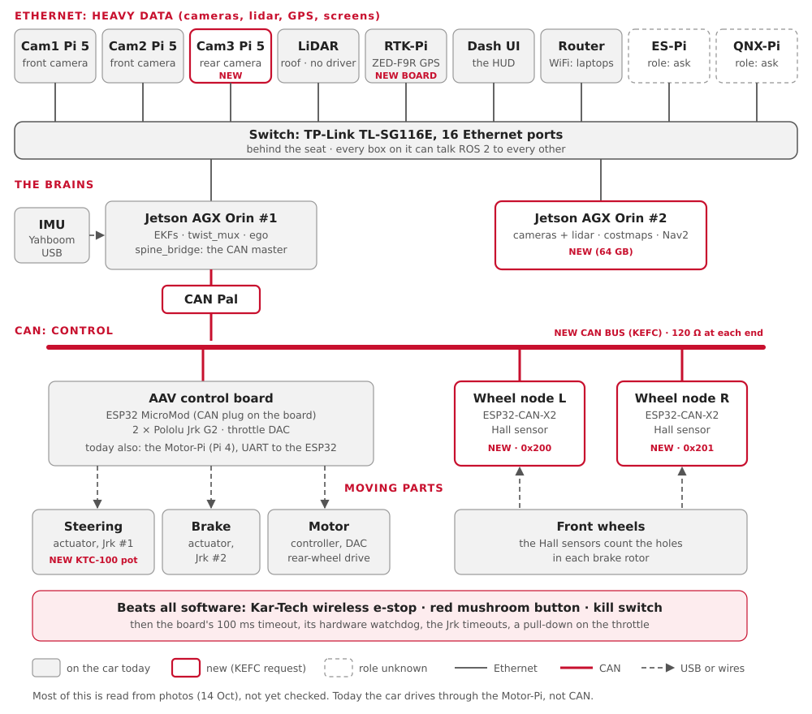

# The car, box by box

Every computer, board, sensor and motor on the car: what it does, and which wire it
talks on. Today, and after the KEFC changes.

**You'll learn:**
- the four kinds of wire on the car: Ethernet, CAN, USB and UART;
- what each box does, in one line;
- what changes when the KEFC request is built.

!!! warning "Mostly from photos"
    Much of this page comes from Ben's photos of 14 October ([Car photos](car-photos.md)).
    A box marked *photos* is "from the photos, not yet checked". The audit on Friday
    16 October checks it.

## The picture



Read it top to bottom:

| Layer | What travels there |
|---|---|
| Ethernet | heavy data: camera pictures, lidar points, GPS, the screens |
| The brains | two Jetson Orins: one drives, one sees and plans |
| CAN | small, urgent control messages: steer, brake, speed |
| Moving parts | the actuators and the motor, wired to the control board |
| Safety | the buttons that stop the car whatever the software does |

## The four kinds of wire

| Wire | What it is | Good for | On the car |
|---|---|---|---|
| **Ethernet** | the network cable a laptop uses | lots of data, many computers | the switch behind the seat |
| **CAN** | two twisted wires, built for cars | short messages that must arrive on time | new: the Orin, the control board, two wheel nodes |
| **USB** | the plug on any computer | one device into one computer | the IMU; the GPS board into its Pi |
| **UART** | a simple serial line between two chips | one board talking to one board | today: the Motor-Pi to the ESP32 |

The [Glossary](glossary.md) explains each word.

## The computers

| Box | Does | Wire | Today | After KEFC |
|---|---|---|---|---|
| Jetson AGX Orin #1 | the main computer: the EKFs, twist_mux, ego | Ethernet | runs everything | keeps control; becomes the CAN master |
| Jetson AGX Orin #2 (64 GB) | cameras, lidar, costmaps, Nav2 planning | Ethernet | not there | **new** |
| Motor-Pi (Raspberry Pi 4) | turns ego's commands into UART frames for the ESP32 | Ethernet, UART | drives the car | kept until CAN is proven, then retired |
| Cam1-Pi, Cam2-Pi (Pi 5) | the two front cameras, at the windscreen (*photos*) | Ethernet | there | the same |
| Cam3-Pi (Pi 5) | the rear camera (*photos*: a camera is fitted at the back; is it wired?) | Ethernet | maybe | **new** |
| RTK-Pi (Pi, on the ceiling panel) | reads the GPS board over USB (*photos*) | Ethernet, USB | there | the same, with RTK corrections |
| Dash-UI | the in-car screen, the [HUD](hud.md) (*photos*) | Ethernet | there | the same |
| ES-Pi | unknown: an e-stop Pi? (*photos*: a port label only) | Ethernet | ? | not in the KEFC picture |
| QNX-Pi | probably the 2025-26 QNX layer, now replaced by twist_mux (*photos*: a port label only) | Ethernet | ? | not in the KEFC picture |

## The network boxes

| Box | Does | Seen |
|---|---|---|
| TP-Link TL-SG116E switch, 16 ports | joins every Ethernet box | photos: its ports are labelled |
| Linksys EA3500 router | the car's WiFi, so laptops can join | photos |
| CAN Pal | a CAN transceiver on Orin #1's 40-pin header | **new** (KEFC) |


## The boards

| Box | Does | Wire | Today | After KEFC |
|---|---|---|---|---|
| AAV control board | carries the ESP32, two Jrk G2s and the throttle DAC | UART today, CAN after | runs the 2025-26 firmware | becomes the CAN node that steers, brakes and drives |
| ESP32 MicroMod | the microcontroller on that board | | 2025-26 C++ firmware, **no command timeout** | new firmware: 100 ms timeout, watchdog, speed loop |
| Wheel encoder (Pico 2 + W5500) | counts wheel spokes, sends them over UDP to the Motor-Pi | Ethernet | runs today | replaced by the wheel nodes |
| Wheel node L, R (ESP32-CAN-X2) | count Hall-sensor pulses from the front brake-rotor holes; wheel speed on CAN | CAN (0x200 L, 0x201 R, 100 Hz) | not there | **new** |
| ZED-F9R GPS board (SparkFun) | GPS position, to a Pi over USB-C | USB | fitted; its antenna lead is held by tape (*photos*) | a new board, same chip, screw-on antenna, RTK |


The board already has a white CAN plug, labelled CANH / CANL (*photos*). Is its
transceiver chip (U7) fitted? The audit checks.

## The sensors

| Sensor | Measures | Wire | In our code |
|---|---|---|---|
| IMU (Yahboom) | turn rate and acceleration | USB, to which computer? | `yahboom_imu_cpp`, `aav_imu_yahboom` |
| GPS (u-blox ZED-F9R) | latitude and longitude | USB to the RTK-Pi | `ublox_gps` (the default) |
| Wheel speed | how fast the wheels turn | today UDP; later CAN | `encoder_udp`; later `spine_bridge` |
| Lidar, on the roof (*photos*) | 3D points around the car | Ethernet | **no driver yet**; model unknown (Q22) |
| Cameras | pictures | Ethernet, through their Pis | `usb_cam` (expects USB cameras) |
| TI radar | points ahead of the car | USB | `ti_ros2_driver`; not seen in the photos |
| Battery monitor (Victron) | battery voltage and charge | USB (VE.Direct cable) | `battery_monitor` |
| Steering position (KTC-100 pot) | where the front wheels point | wire, into the steering Jrk | **new**: the board reads it from the Jrk |


## The moving parts

| Part | Does | Driven by |
|---|---|---|
| Steering actuator | turns the front wheels | Jrk G2 #1 (I2C address 0x05) |
| Brake actuator | presses the brake | Jrk G2 #2 (I2C 0x04) |
| Throttle DAC | a voltage that sets the motor's power | the ESP32 (I2C 0x0C) |
| Motor controller | powers the rear-wheel-drive motor (*photos*: silver finned box) | the DAC's voltage |
| Pololu Jrk G2 | a small motor driver with feedback: "go to position X" | the ESP32, over I2C |

## Power and safety

| Part | Does | Seen |
|---|---|---|
| Kar-Tech wireless e-stop | a remote stop; beats all software | photos: "ROS ON/OFF" written beside it |
| Red mushroom e-stop button | stops the car on its own wiring | photos: on the left frame tube |
| Kill switch | cuts the drive | KEFC request |
| RC transmitter and receiver (FlySky) | a person can take over by radio | firmware: iBUS on the ESP32 |
| E-stop board (TR, ES lights), 8 relays | the e-stop's trigger and status | photos |
| Battery box, fuse blocks, 12 V → 5 V converters | power for everything | photos: one converter at 3.5 A (is it enough for a Pi 5?) |

## Today vs after the KEFC changes

| | Today | After KEFC |
|---|---|---|
| Command path | Orin → Ethernet → Motor-Pi → UART → ESP32 | Orin #1 → CAN → ESP32 control board |
| If the computer freezes | **the last throttle stays on**: no timeout | the board brakes after 100 ms |
| Wheel speed | Pico 2 → UDP → Motor-Pi | two wheel nodes → CAN, 100 Hz |
| Steering position | not measured | KTC-100 pot through the Jrk |
| GPS | ZED-F9R, taped antenna lead | new board, screw-on antenna, RTK |
| Perception and Nav2 | on Orin #1 | on Orin #2 |

The rollout, from the KEFC request: write the DBC first; test on the bench with a CANable
and `candump`; keep the Motor-Pi path until CAN is proven; **never run both at once**.
Details: [CAN plan](can-plan.md).

## Try it

```bash
pixi run bench        # the car's software, with stand-ins for every box above
pixi run bench-check  # start it and check the whole graph (2 min)
pixi run view         # the car's 3D model and its sensor frames, in RViz
```

On the car's network, once it runs Jazzy: `pixi run doctor` says whether your laptop can
see the car.

## Where this lives in the code

| What | Where |
|---|---|
| Which program runs on which computer | `src/aav_bringup/config/machines/` (`orin`, `motor_pi`, `laptop`, `all`) |
| Where each sensor sits on the car | `src/aav_description/config/vehicle.yaml` |
| Today's car | `src/backends/aav_legacy`, `firmware/legacy/` |
| The CAN car | `src/backends/aav_spine`, `firmware/can/aav.dbc`, `firmware/spine/` |
| The sensor drivers | `src/sensors/` |

Next: [A command's journey](learn-journey.md) follows one joystick push through these
boxes.
